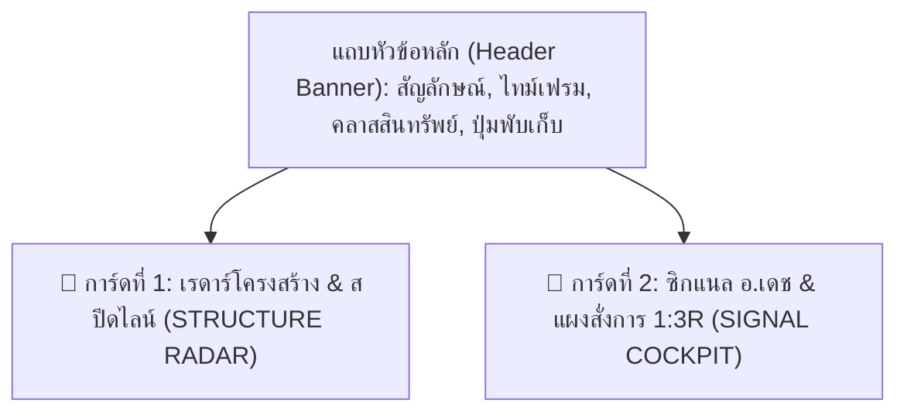
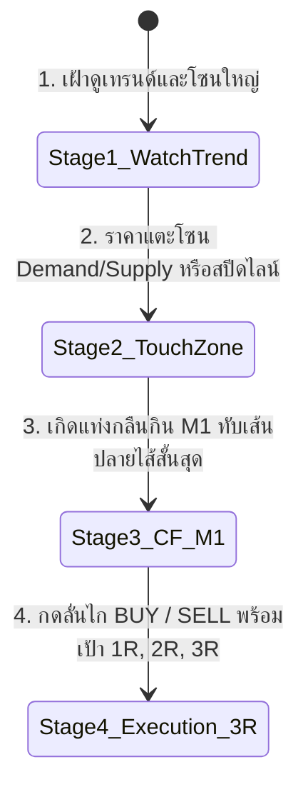
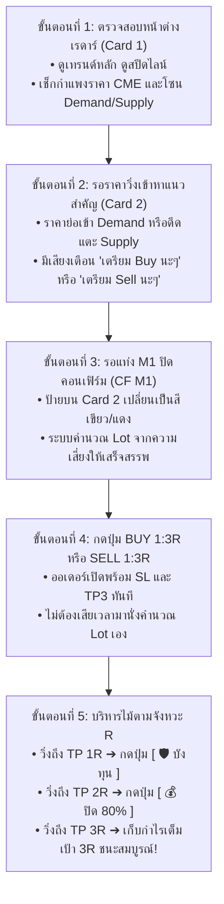

# 📖 คู่มือการใช้งาน EA DeungDang_Trade (ฉบับสมบูรณ์)
### Good Trade Gold & Kamnan Ball Trading Suite • Version 2.27
*Visual Training Co-Pilot & Manual Precision Radar*

---

## 1. บทนำและปรัชญาการเทรด (Overview & Concept)

**EA DeungDang_Trade** ถูกออกแบบขึ้นมาเพื่อทำหน้าที่เป็น **"Co-Pilot เรดาร์นำทางและแผงสั่งการเทรดด้วยมือ (Manual Trading Cockpit)"** โดยนำจุดแข็งจากศาสตร์การเทรดชั้นครูมารวมไว้ในที่เดียว:

1. **สูตรกำนันบอล (Kamnan Ball):** เน้นโครงสร้างสวิงไฮ-โลว์ (Swing High/Low), สปีดไลน์นำเทรนด์ (Speedlines), Demand/Supply Zone, แท่งเทียนไส้ยาวซ่อนมีด (Hidden Blade Wicks) และการเบรกโครงสร้าง (BOS / CHoCH)
2. **สูตรอาจารย์เดช (Ajarn Dech DTD):** ระบบคอนเฟิร์ม **CF M1** ที่คมที่สุด เข้าออเดอร์โดยอ้างอิง **"เส้นเกาะปลายไส้ที่สั้นที่สุด"** ร่วมกับแท่งกลืนกิน (Engulfing Candle) บริหารหน้าตักด้วยอัตราส่วนผลตอบแทนต่อความเสี่ยง **1:3R (Risk-Reward 1:3)** เสมอ
3. **สูตรพี่ชนัฐ:** การอ่านโมเมนตัมและทิศทางเทรนด์สถิติ 100% ด้วยเส้น **Multi-TF EMA 14 Matrix (M1 ถึง D1)**
4. **SAMURAI MTF Strip:** แถบไฟสถานะแท่งเทียน 9 ไทม์เฟรม พร้อม Golden Flash Alert เตือนก่อนแท่งปิด 15 วินาที
5. **สถาบันการเงิน & Options:** กำแพงราคา CME Options Matrix (Open Interest) และการสแกนหาจุดดักกินสภาพคล่อง (BSL / SSL Liquidity Pools)

> [!IMPORTANT]
> **DeungDang_Trade ไม่ใช่บอทที่เปิดออเดอร์มั่วซั่วอัตโนมัติ** แต่เป็นระบบผู้ช่วยนักบิน (Co-Pilot) ที่คอยคำนวณความเสี่ยง ช่วยชี้เป้าจุดเข้าที่ได้เปรียบ คอยแจ้งเตือนด้วยเสียง และมีปุ่มกดออกไม้-บริหารไม้อย่างแม่นยำ

---

## 2. โครงสร้างหน้าต่างแดชบอร์ด 2 การ์ดหลัก (2-Card Master HUD)

หน้าจอแสดงผลถูกจัดระเบียบให้กระชับ ชัดเจน และลดความซ้ำซ้อน โดยแบ่งออกเป็นแถบหัวข้อและ 2 การ์ดหลัก:

### 2.1 แถบหัวข้อหลัก (Header Banner)
- **ชื่อระบบ & เวอร์ชัน:** แสดง `DeungDang_Trade V2.27`
- **ข้อมูลตลาด:** แสดงคู่เงิน/ทองคำ (`XAUUSD`), ไทม์เฟรมปัจจุบัน (`[M15]`) และประเภทสินทรัพย์ (`ทองคำ (GOLD)`)
- **ปุ่ม `[ ◀ พับเก็บ ]` / `[ ▶ ขยาย ]`:** กดเพื่อย่อเก็บหน้าต่างแดชบอร์ดทั้งหมด เหลือเพียงแถบเล็ก ๆ เพื่อเปิดพื้นที่กราฟให้โล่งตา

---

### 2.2 การ์ดที่ 1: เรดาร์โครงสร้าง & สปีดไลน์ (Card 1: STRUCTURE RADAR)
ทำหน้าที่สแกนภาพรวมของตลาดในภาพใหญ่ เพื่อบอกว่าฝั่งใดกำลังได้เปรียบ:

| แถวข้อมูล | ความหมายและการนำไปใช้งาน |
| :--- | :--- |
| **สปีดไลน์ (Speedlines)** | แสดงสถานะเส้นความเร็วเทรนด์: กำลังวิ่งขึ้น (เส้นน้ำเงิน), วิ่งลง (เส้นส้ม) หรือทะลุเบรกเส้นแล้ว (เส้นประ) |
| **โครงสร้างสวิง (Swings)** | แสดงจำนวนยอดไฮและฐานโลว์ล่าสุด เช่น `HH 3 | HL 2 | LH 1 | LL 2` และสรุปว่าเกิด BOS (Break of Structure) แล้วหรือไม่ |
| **สภาวะตลาด (Regime)** | ระบุว่าเป็น **เทรนด์แข็งแกร่ง (Trending)**, **ไซด์เวย์ (Sideway)** หรือ **มีสัญญาณกลับตัวหลอก (Trap/Fakeout)** |
| **คลื่น A-B-C-D** | คำนวณคลื่นฮาร์โมนิก พร้อมเป้าหมาย Wave D 161.8% |
| **CME Options Wall** | แสดงราคากำแพงแนวต้าน Call และกำแพงแนวรับ Put ที่มีสัญญาคงค้างสูงสุด (Open Interest) จากตลาด CME |
| **Gann Equilibrium 45°** | แสดงระดับราคาแกนสมดุลพลังงานและสภาวะการสะสมแรงของแท่งเทียน |

---

### 2.3 การ์ดที่ 2: ซิกแนล อ.เดช & แผงสั่งการ 1:3R (Card 2: SIGNAL COCKPIT)
นี่คือ **"ห้องควบคุมหลัก"** ที่ใช้สำหรับการตัดสินใจออกออเดอร์และการบริหารเงินทุน:

#### แถบสถานะซิกแนล (Signal Status Banner):
- 🟢 **`[ จบแท่งกลืนกิน BUY • พร้อมลั่นไก 1:3R! ]`** : เกิดแท่งกลืนกิน M1 ยืนยันแล้ว สามารถกดปุ่ม BUY ได้ทันที
- 🔴 **`[ จบแท่งกลืนกิน SELL • พร้อมลั่นไก 1:3R! ]`** : เกิดแท่งกลืนกิน M1 ฝั่งเซลล์ ยืนยันแล้ว สามารถกดปุ่ม SELL ได้ทันที
- 🟢 **`[ จังหวะย่อรีเทสต์! • จุดขึ้นรถ BUY ราคาดีที่สุด ]`** : ราคาย่อกลับมาแตะเส้นไส้สั้นสุด ได้ระยะ SL ที่แคบมาก
- 🔴 **`[ จังหวะดีดรีเทสต์! • จุดขึ้นรถ SELL ราคาดีที่สุด ]`** : ราคาดีดกลับมาแตะแนวไส้สั้นสุด
- ⚠️ **`[ แผน BUY/SELL วิ่งทำกำไร • ห้ามไล่ราคา! ]`** : ราคาพุ่งเกินจุดปลอดภัยแล้ว คำสอน อ.เดช คือ "ห้ามไล่ยอดดอย / ห้ามไล่ก้นเหว" ให้รอจังหวะใหม่
- 🛡️ **`[ บรรลุเป้า TP 1R • บังหน้าทุนทันที! ]`** : วิ่งบวกถึงระยะ 1 เท่าของความเสี่ยง (+1R) ให้กดปุ่มบังทุน
- 🎯 **`[ บรรลุเป้า TP 2R • ล็อกกำไร ]`** : วิ่งบวกถึงระยะ 2 เท่า (+2R) ให้เลื่อน SL บังใต้ TP1 หรือปิดแบ่งกำไร 80%
- 🏆 **`[ บรรลุเป้าหมาย 3R สำเร็จ! ]`** : ชนเป้าหลัก 3R ปิดจบไม้เข้าพอร์ต

---

## 3. สัญลักษณ์และเส้นต่าง ๆ บนหน้าต่างกราฟ (On-Chart Elements)

บนหน้าต่างกราฟจะมีเส้นและป้ายราคาช่วยบอกจุดสำคัญทางเทคนิค ดังนี้:

### 3.1 เส้นประ Multi-TF EMA 14 Matrix (M1 ถึง D1)
เส้นค่าเฉลี่ยเอ็กซ์โพเนนเชียล 14 แท่งของแต่ละไทม์เฟรม ใช้เป็นแนวรับ-แนวต้านไดนามิก:
- ⚡ **EMA 14 [M1]** สีฟ้าอ่อน (Sky Blue)
- 💧 **EMA 14 [M5]** สีฟ้าสว่างนีออน (Neon Cyan)
- 🟢 **EMA 14 [M15]** สีเขียวสปริง (Spring Green)
- 🟡 **EMA 14 [M30]** สีทอง (Gold)
- 🟠 **EMA 14 [H1]** สีส้มคอรัล (Coral Orange)
- 🟣 **EMA 14 [H4]** สีม่วงออร์คิด (Orchid Purple)
- 🔴 **EMA 14 [D1]** สีแดงกุหลาบ (Rose Red)
> [!NOTE]
> ป้ายบอกราคาจะถูกล็อกติดกับระดับเส้นจริงเสมอ (`lblVal = val`) และจัดระดับการเหลื่อมไปทางขวาเมื่อเส้นเกาะกลุ่มกัน ทำให้ตัวเลขตรงกับสเกลราคาบนแกนขวา 100%

### 3.2 ชุดเส้น CF M1 (อ.เดช 1:3R)
เมื่อตรวจพบการคอนเฟิร์มใน M1 จะมีเส้นแสดงแผนการเทรดปรากฏขึ้น:
1. **เส้นสีม่วงเข้ม (Shortest Wick Line):** เส้นระดับปลายไส้ที่สั้นที่สุดของแท่งเทียนต้นเรื่อง
2. **เส้นสีเขียว/แดง (Entry Line):** ระดับราคาเปิดออเดอร์ (ราคาปิดของแท่งกลืนกิน M1)
3. **เส้นสีส้ม/ชมพู (SL Line):** ระดับตัดขาดทุน วางใต้/เหนือชุดคอนเฟิร์ม M1 เผื่อสเปรดเล็กน้อย
4. **เส้นเป้าหมาย 3 ระดับ:**
   - **TP 1R (1 เท่าของ SL):** จุดขยับ SL มาบังหน้าทุน
   - **TP 2R (2 เท่าของ SL):** จุดล็อกกำไร หรือพิจารณาแบ่งปิด 80%
   - **TP 3R (3 เท่าของ SL):** เป้าหมายหลักตามตำราอาจารย์เดช

### 3.3 เส้นสปีดไลน์ (Speedlines)
- **เส้นทึบสีน้ำเงิน/ส้ม:** แนวต้าน/แนวรับความเร็วของเทรนด์ตามสูตรกำนันบอล
- **เส้นประ (Broken Speedline):** สปีดไลน์ที่ถูกแท่งเทียนทะลุผ่านแล้ว มักเป็นจุดเปลี่ยนผ่านของโมเมนตัม

### 3.4 โซน Demand / Supply & Hidden Blade Wicks
- **กล่องสีเขียวโปร่งแสง:** Demand Zone (โซนรอ Buy)
- **กล่องสีแดงโปร่งแสง:** Supply Zone (โซนรอ Sell)
- **ป้ายมีดสั้น (Hidden Blade):** แท่งเทียนที่มีไส้ยาวเกิน 50% ของตัวแท่ง แสดงแรงปฏิเสธราคาอย่างรุนแรง

---

## 4. แผงปุ่มสั่งการเทรดด้วยมือ (Control Buttons Guide)

บน Card 2 ด้านล่าง จะมีแผงปุ่มสำหรับบริหารจัดการออเดอร์:

| ปุ่มสั่งการ | หน้าที่การทำงาน | คำแนะนำในการใช้งาน |
| :---: | :--- | :--- |
| `[ 🛒 BUY 1:3R ]` | เปิดออเดอร์ BUY ทันที โดยคำนวณ Lot อัตโนมัติจากเงินความเสี่ยงที่ตั้งไว้ ÷ ระยะ SL พร้อมตั้ง SL และ TP3 ให้อัตโนมัติ | กดเมื่อมีสัญญาณคอนเฟิร์มฝั่ง BUY หรือราคาย่อแตะแนวรับที่ได้เปรียบ |
| `[ 🏷️ SELL 1:3R ]` | เปิดออเดอร์ SELL ทันที คำนวณ Lot อัตโนมัติ พร้อมตั้ง SL และ TP3 ให้อัตโนมัติ | กดเมื่อมีสัญญาณคอนเฟิร์มฝั่ง SELL หรือราคาดีดแตะแนวต้าน |
| `[ 🛡️ บังทุน ]` | ดึงเส้น SL ของทุกไม้มาวางเหนือราคาเปิดเล็กน้อย (+เผื่อสเปรด) | กดทันทีที่ราคาแตะ TP 1R เพื่อตัดความเสี่ยงของพอร์ตให้เหลือศูนย์ |
| `[ 💰 ปิด 80% ]` | ปิดทำกำไรก้อนใหญ่ 80% ของขนาด Lot เข้าพอร์ตทันที พร้อมขยับ SL ของอีก 20% ที่เหลือมาบังทุน | กดเมื่อราคาแตะ TP 2R เพื่อเก็บกำไรเข้ากระเป๋า และปล่อย 20% รันหา TP3 |
| `[ ❌ ปิดทั้งหมด ]` | สั่งปิดออเดอร์ทั้งหมดของคู่นี้ทันทีในคลิกเดียว | ใช้เมื่อต้องการล้างพอร์ต ปิดจบงาน หรือสภาวะตลาดเปลี่ยนทิศ |
| `[ - ]` / `[ + ]` | ปรับเพิ่ม/ลดขนาด Lot สำหรับไม้ถัดไป | ใช้งานกรณีต้องการระบุ Lot ตามดุลยพินิจของนักเทรดเอง |

---

## 5. ขั้นตอนการเทรดจริงตามตำรา (Step-by-Step Practical Trading)

เพื่อให้เกิดประสิทธิภาพสูงสุดตามหลักการของกำนันบอลและ อ.เดช ขอแนะนำขั้นตอนการเทรดดังนี้:

---

## 6. กฎเหล็กและข้อควรระวังสำคัญ (Golden Rules)

> [!CAUTION]
> **3 กฎเหล็กที่ต้องรักษาอย่างเคร่งครัด:**
> 1. **ห้ามไล่ราคาเด็ดขาด (Anti-Chasing):** เมื่อป้ายขึ้นเตือนสีทองว่า "ห้ามไล่ราคา" แปลว่าระยะความคุ้มค่า (R:R) เสียเปรียบแล้ว การไล่เปิดออเดอร์จะทำให้ระยะ SL กว้างเกินไปและเสี่ยงโดนลาก
> 2. **อย่าเลื่อน SL หนี:** ระบบวาง SL อิงจากโครงสร้างแท่งเทียน หากผิดทางยอมเสียตามความเสี่ยงที่คำนวณไว้ ห้ามถอย SL เป็นอันขาด
> 3. **แตะ 1R ต้องบังหน้าทุน:** ทันทีที่กราฟวิ่งบวกไปแตะระยะเท่ากับความเสี่ยง ให้กดปุ่ม `[ 🛡️ บังทุน ]` ทันที การทำเช่นนี้จะเปลี่ยนไม้เทรดนั้นให้กลายเป็น **"ไม้ที่ไม่มีวันแพ้"**

---

## 7. ตารางสรุปพารามิเตอร์การตั้งค่า (Settings Reference)

| กลุ่มการตั้งค่า | ตัวแปร (Variable) | ค่าเริ่มต้น | หน้าที่และการทำงาน |
| :--- | :--- | :---: | :--- |
| **1. Manual Cockpit** | `InpMagicNumber` | 789100 | หมายเลขประจำตัวออเดอร์ของ EA |
| | `InpDefaultLot` | 0.01 | ขนาด Lot เริ่มต้น |
| | `InpSharedSL_Gold` | 1000 | ระยะ SL มาตรฐานของทองคำ (จุด) |
| | `InpBE_BufferPts` | 50 | ระยะกำไรที่เผื่อไว้เหนือจุดเปิดเมื่อกดบังหน้าทุน (จุด) |
| **2. กฎกำนันบอล** | `InpSwingBars` | 3 | จำนวนแท่งซ้าย-ขวาในการตรวจจับสวิงไฮ/โลว์ |
| | `InpMaxBarsScan` | 150 | จำนวนแท่งย้อนหลังที่ใช้สแกนหาโครงสร้าง |
| | `InpEMA_Period` | 14 | ค่าคาบเวลาของเส้น EMA (14 แท่ง) |
| **3. ซิกแนล CF M1 อ.เดช** | `InpUseDTD_CF_M1` | `true` | เปิดใช้งานระบบคอนเฟิร์ม CF M1 ปลายไส้สั้นสุด |
| | `InpDTD_RiskMoney` | 20.0 | **เงินความเสี่ยงต่อไม้ ($ หรือ USC)** ใช้คำนวณ Lot อัตโนมัติ |
| | `InpDTD_TargetRR` | 3.0 | อัตราส่วนความคุ้มค่า (แนะนำ 3.0 = 1:3R) |
| | `InpDTD_SL_BufferPts` | 35 | ระยะเผื่อสเปรดใต้/เหนือจุดคอนเฟิร์ม M1 (จุด) |
| | `InpRequireM15_Alignment`| `true` | กฎเหล็ก: ทิศทาง M1 ต้องสอดคล้องกับเทรนด์ M15 เท่านั้น |
| **4. การแสดงผล & เส้น** | `InpShowHUD` | `true` | แสดงแผงแดชบอร์ดบนหน้าจอ |
| | `InpShowMultiTF_EMA14` | `true` | แสดงเส้นประ Multi-TF EMA 14 บนกราฟ |
| | `InpUseTF_Colors_EMA14` | `true` | แยกสีเฉพาะตามไทม์เฟรมของเส้น EMA |
| | `InpEnableVoiceAlert` | `true` | เปิดระบบเสียงเตือน "เตรียม Buy นะๆ" / "เตรียม Sell นะๆ" |
